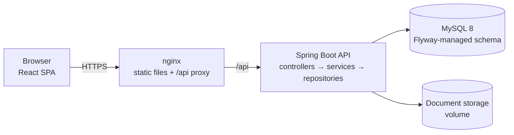
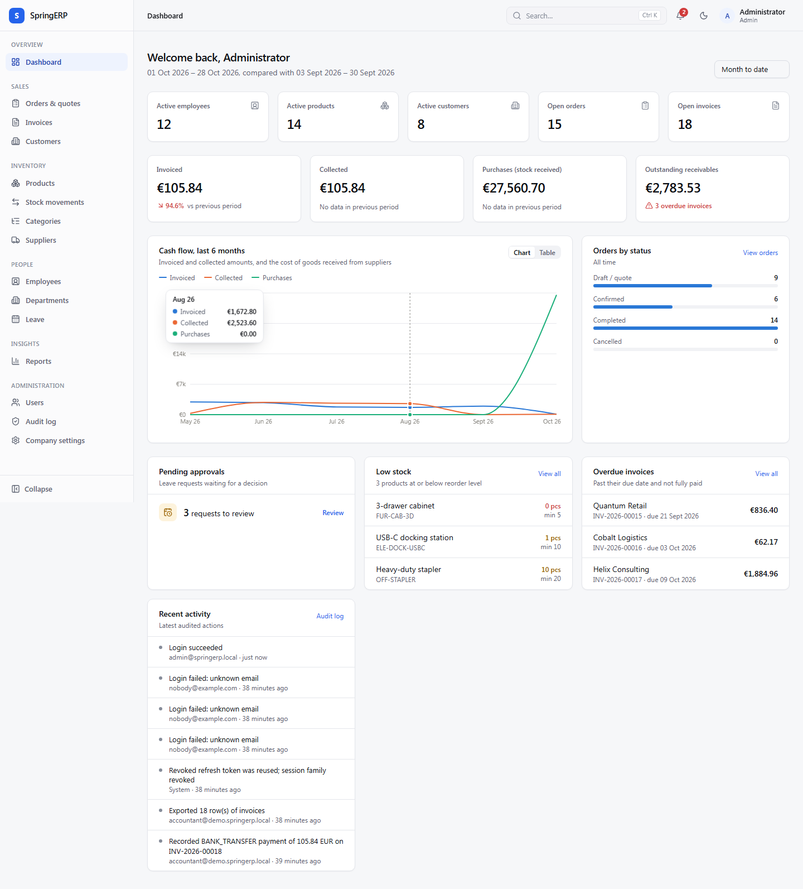
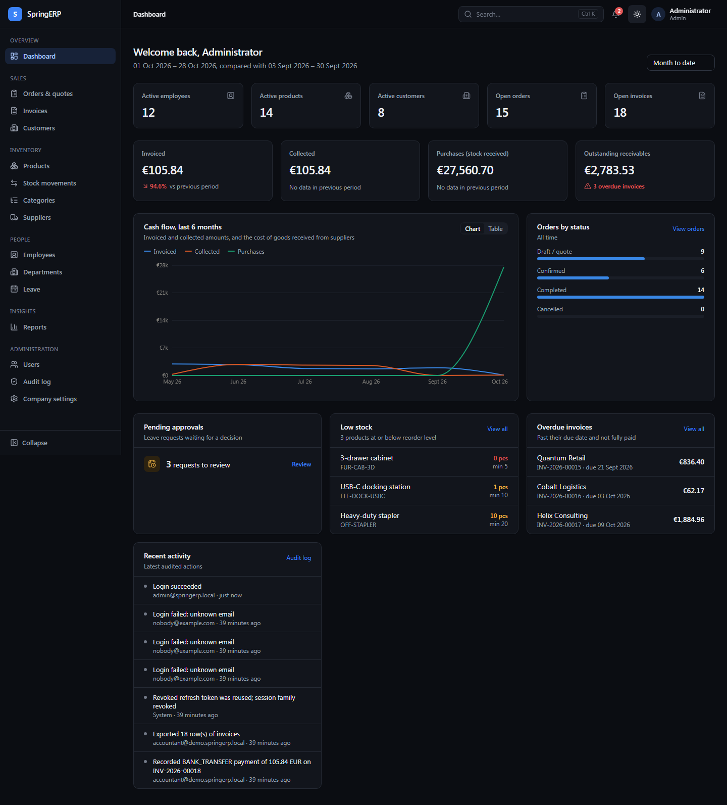
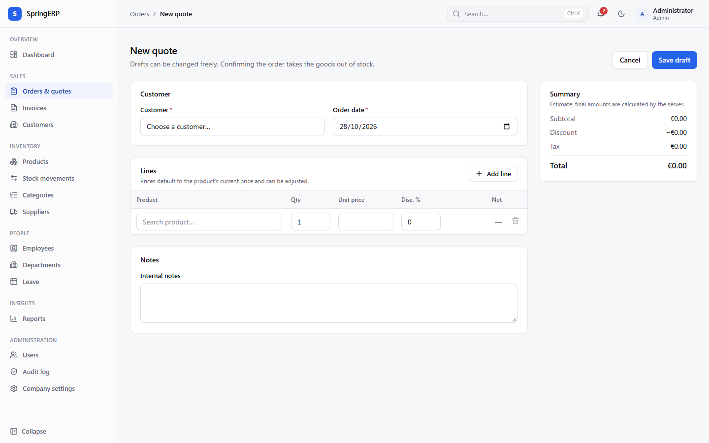
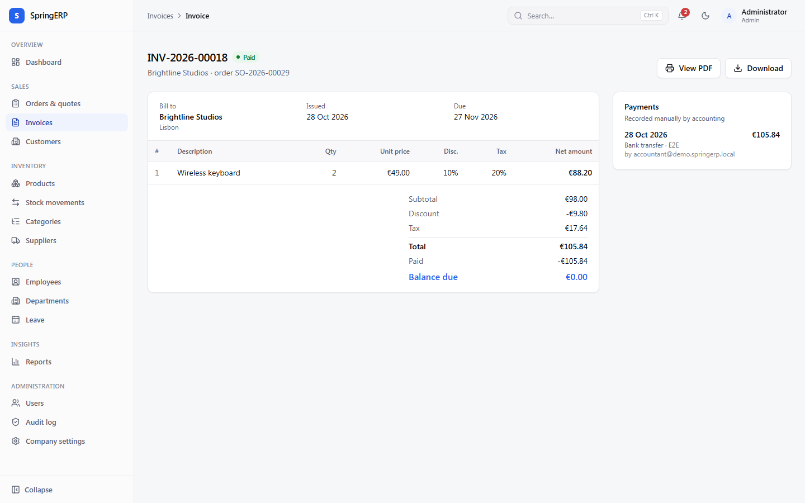
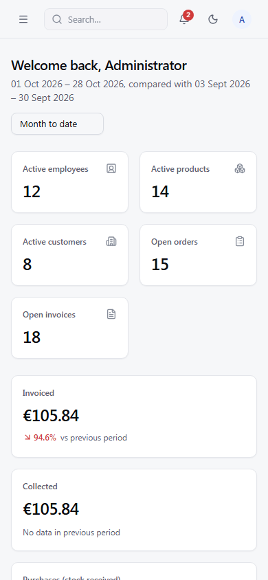

# SpringERP

A full-stack Enterprise Resource Planning platform for small and mid-sized companies:
sales and invoicing, inventory, customers and suppliers, human resources, reporting,
notifications and an audit trail, behind role-based access control.

**Stack:** Java 17 · Spring Boot 3.5 · Spring Security (JWT + rotating refresh tokens) ·
Spring Data JPA / Hibernate · Flyway · MySQL 8 · React 19 · TypeScript (strict) · Vite ·
TanStack Query · React Hook Form + Zod · Tailwind CSS 4 · Radix UI · Recharts ·
JUnit 5 · Testcontainers · Vitest · Playwright · Docker · GitHub Actions

---

## Features

| Module | What it does |
|---|---|
| **Authentication & users** | Login/logout, short-lived access tokens kept in memory, HttpOnly rotating refresh cookie with reuse detection, account lockout, login rate limiting, temporary passwords that must be changed, 7 roles mapped to 20 permissions, user activation/deactivation |
| **Company & organization** | Company profile (currency, time zone, tax rate, payment terms, invoice footer), department tree with managers, employee records with status history |
| **Inventory** | Products with SKU, prices, tax rate, reorder level; categories; stock receipts, issues and count adjustments; an immutable stock ledger; low-stock alerts; row-locked updates that can never oversell |
| **Customers & suppliers** | Profiles, contact details, duplicate detection (email, tax ID, same name in same city), order and invoice history |
| **Sales** | Quotes (drafts) → confirmed orders (stock deducted atomically) → completed; cancellation returns stock; decimal-safe line pricing with discounts and tax |
| **Invoicing & payments** | Gap-free invoice numbering, snapshot of lines and billing details, due dates, partial payments, outstanding balance, overdue tracking, printable PDF, CSV export. Payments are *recorded* by staff; no payment provider is simulated |
| **Human resources** | Leave requests with working-day calculation, overlap detection and approval workflow; employment documents (PDF/PNG/JPEG, validated by content) |
| **Reporting** | Dashboard with live KPIs and period-over-period comparison; sales & cash, inventory valuation and headcount reports with CSV export |
| **Notifications & audit** | In-app notifications for business events (low stock, leave, orders, payments); searchable append-only audit log of security and business actions |

All figures shown in the UI come from the database. The optional demo dataset is clearly
fictional and disabled by default.

## Architecture



The browser only ever talks to one origin. The API is stateless (bearer access token);
sessions are carried by a refresh cookie scoped to `/api/auth`. See
[docs/ARCHITECTURE.md](docs/ARCHITECTURE.md).

## Screenshots

Captured from the running application (React + Spring Boot + MySQL 8) with the fictional
demo dataset.

| Dashboard | Dark theme |
|---|---|
|  |  |

| Quote editor | Invoice | Mobile |
|---|---|---|
|  |  |  |

## Quick start (local, without Docker)

**Prerequisites:** Java 17+, Node.js 20.19+ or 22+, MySQL 8 running locally.
Maven is not required (the Maven Wrapper is included).

```bash
# 1. Configuration (local secrets live in a git-ignored .env at the repo root)
cp .env.example .env
#    edit .env: DB_URL / DB_USERNAME / DB_PASSWORD, APP_JWT_SECRET,
#    APP_BOOTSTRAP_ADMIN_EMAIL / APP_BOOTSTRAP_ADMIN_PASSWORD, APP_COOKIE_SECURE=false

# 2. API (http://localhost:8080) - Flyway creates the schema on first start
cd backend
./mvnw spring-boot:run            # Windows PowerShell: .\mvnw.cmd spring-boot:run

# 3. Frontend (http://localhost:5173, proxies /api to :8080)
cd ../frontend
npm ci
npm run dev
```

Sign in with the bootstrap administrator from `.env`.

**Demo data:** set `APP_DEMO_DATA=true` (and optionally `APP_DEMO_USER_PASSWORD` to get
one account per role, e.g. `sales@demo.springerp.local`) before the first start on an
empty database. It creates fictional customers, products, orders, invoices and employees.

**No MySQL at hand?** `./mvnw spring-boot:run -Dspring-boot.run.profiles=local` runs on a
file-based H2 database in MySQL mode with the same migrations, and prints a one-time
administrator password. In PowerShell, quote the property:
`.\mvnw.cmd spring-boot:run "-Dspring-boot.run.profiles=local"`.

## Docker

```bash
cp .env.example .env      # fill in MYSQL_*, APP_JWT_SECRET, APP_BOOTSTRAP_ADMIN_*
docker compose up -d --build
# open http://localhost:8081  (set APP_COOKIE_SECURE=false for plain-http local use)
```

MySQL is not published on the host. Production with automatic HTTPS:
`DOMAIN=erp.example.com docker compose --profile https up -d`.
See [docs/DEPLOYMENT.md](docs/DEPLOYMENT.md).

## Environment variables

| Variable | Purpose | Default |
|---|---|---|
| `DB_URL`, `DB_USERNAME`, `DB_PASSWORD` | MySQL connection | `jdbc:mysql://localhost:3306/springerp…`, `springerp`, — |
| `APP_JWT_SECRET` | HMAC key for access tokens, ≥ 32 bytes (`openssl rand -base64 48`) | **required** |
| `APP_ACCESS_TOKEN_TTL` / `APP_REFRESH_TOKEN_TTL` | Token lifetimes (ISO-8601) | `PT15M` / `P7D` |
| `APP_COOKIE_SECURE` | `Secure` flag on the refresh cookie; `false` only for plain-http dev | `true` |
| `APP_CORS_ALLOWED_ORIGINS` | Comma-separated origins for cross-origin use (same-origin needs none) | empty |
| `APP_BOOTSTRAP_ADMIN_EMAIL` / `APP_BOOTSTRAP_ADMIN_PASSWORD` | First administrator, created only when no user exists | — |
| `APP_DEMO_DATA`, `APP_DEMO_USER_PASSWORD` | Optional fictional dataset (forced off in `prod`) | `false` |
| `APP_DOCUMENTS_DIR` | Storage directory for employee documents | `./data/documents` |
| `SPRING_PROFILES_ACTIVE` | `prod` enables JSON logs and disables Swagger UI | — |
| `MYSQL_ROOT_PASSWORD`, `MYSQL_DATABASE`, `MYSQL_USER`, `MYSQL_PASSWORD` | Docker Compose only | — |

## Database and migrations

The schema is owned by Flyway (`backend/src/main/resources/db/migration`) and applied
automatically at startup; Hibernate only validates it (`ddl-auto=validate`). Never edit an
applied migration: add `V5__…sql`. Details and the ER diagram: [docs/DATABASE.md](docs/DATABASE.md).

## Tests

```bash
cd backend && ./mvnw test        # unit + integration (H2) + MySQL migration test (needs Docker)
cd frontend && npm run lint && npm run typecheck && npm test && npm run build
cd frontend && E2E_ADMIN_EMAIL=… E2E_ADMIN_PASSWORD=… npm run e2e   # stack must be running
```

See [docs/TESTING.md](docs/TESTING.md) for what is covered and the latest results.

## API documentation

With the API running outside the `prod` profile: Swagger UI at
`http://localhost:8080/api/docs/ui`, OpenAPI JSON at `/api/docs`. Conventions, error format
and the endpoint list: [docs/API.md](docs/API.md).

## Project layout

```
backend/   Spring Boot API (package per module: auth, user, hr, inventory, partner, sales, invoicing, report…)
frontend/  React SPA (app/, components/, features/<module>/, hooks/, lib/, types/)
deploy/    Caddyfile for HTTPS termination
docs/      Architecture, database, API, security, testing, deployment, roadmap
```

## Troubleshooting

| Symptom | Fix |
|---|---|
| PowerShell: `mvnw.cmd is not recognized` | PowerShell does not run programs from the current folder; use `.\mvnw.cmd` |
| `APP_JWT_SECRET must be set` at startup | Set a secret of at least 32 bytes in `.env` or the environment |
| "No users exist … nobody can sign in" warning | Set `APP_BOOTSTRAP_ADMIN_EMAIL` and `APP_BOOTSTRAP_ADMIN_PASSWORD`, restart |
| Logged out after every page reload in local dev | `APP_COOKIE_SECURE=false` when serving over plain http |
| `Too many login attempts` (429) | The login limit is 10/min per IP; wait a minute |
| Flyway `Validate failed` | An applied migration was edited; restore it and add a new versioned migration |
| Frontend calls fail with 404 in dev | Start the API on :8080 or set `VITE_DEV_API_PROXY` |
| `npm install` crashes with `reading 'edgesOut'` | Bug in npm 11.0.0; use a newer npm (`npx npm@latest install`) |

## Documentation

[Audit](docs/PROJECT_AUDIT.md) · [Architecture](docs/ARCHITECTURE.md) · [Database](docs/DATABASE.md) ·
[API](docs/API.md) · [Security](docs/SECURITY.md) · [Testing](docs/TESTING.md) ·
[Deployment](docs/DEPLOYMENT.md) · [Roadmap](docs/IMPLEMENTATION_ROADMAP.md)
# -SpringERP

