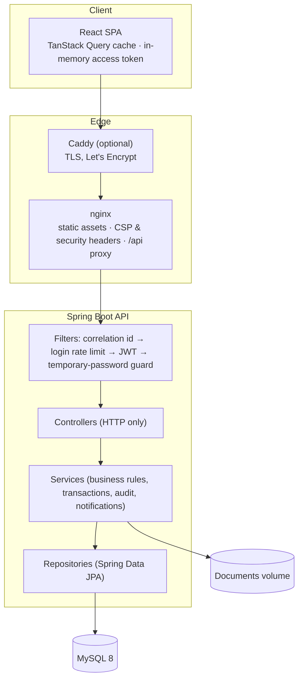

# Architecture

## Overview



A single-origin deployment: nginx serves the SPA and proxies `/api`, so no CORS is
needed and the refresh cookie can be `SameSite=Strict`.

## Backend

Package-by-module (`com.springerp.<module>`), each layered:

| Layer | Responsibility | Example |
|---|---|---|
| Controller | HTTP mapping, validation trigger (`@Valid`), permission (`@PreAuthorize`) | `SalesOrderController` |
| DTO | API contract (Java records) with Bean Validation; explicit `from(entity)` mappers | `SalesDtos.OrderRequest` |
| Service | Business rules, transaction boundaries, audit, notifications | `SalesOrderService.confirm` |
| Repository | Queries (JPQL with whitelisted sorting, entity graphs against N+1) | `ProductRepository.search` |
| Entity | Persistence model; `BaseEntity` adds id, timestamps and `@Version` | `Product` |

Modules: `auth`, `user`, `security`, `audit`, `notification`, `company`, `numbering`,
`hr`, `partner`, `inventory`, `sales`, `invoicing`, `dashboard`, `report`, `search`, `demo`,
plus `common` (errors, pagination, CSV, correlation id) and `config`.

### Key design decisions

| Decision | Rationale |
|---|---|
| Stateless JWT access token (HS256, 15 min) + opaque rotating refresh token stored hashed | Short exposure window; refresh can be revoked server-side; rotation + reuse detection detects stolen tokens |
| Roles → permissions mapped in code (`Role` enum) | Reviewed and versioned with the code that checks them; no admin UI can silently escalate |
| `@Transactional(propagation = MANDATORY)` on `StockService.apply`, `AuditService.record`, `DocumentNumberService` | They must join the caller's transaction so stock, numbering and audit commit or roll back together |
| Pessimistic row locks for stock, invoice payments, order state changes, number sequences | These are contended counters where "retry on conflict" would be a poor UX and correctness is critical |
| Optimistic `@Version` for user-edited records | Two people editing the same product get a 409 instead of a lost update |
| Invoice lines and billing details are snapshots | Issued invoices never change when products or customers are edited |
| Payments are records, not transactions | No payment provider is integrated; the UI says so explicitly |
| Business dates use the company time zone (`CompanyService.today()`); instants are stored in UTC | Consistent "overdue" and report boundaries regardless of server TZ |
| Single company per deployment | Simpler and safer than row-level multi-tenancy; cross-company IDOR is impossible by construction. Multi-tenancy is a roadmap item |
| Errors are RFC 7807 `ProblemDetail` with a stable `code` and the correlation id | Machine-readable for the UI, traceable in logs, no internals leaked |

### Request lifecycle

1. `CorrelationIdFilter` assigns/propagates `X-Correlation-Id` and puts it in the logging MDC.
2. `LoginRateLimitFilter` throttles `POST /api/auth/login` per client IP.
3. Spring Security validates the bearer token (signature, expiry, issuer) and maps the
   `role` claim to permissions.
4. `PasswordChangeRequiredFilter` blocks everything but `/api/auth/**` for temporary passwords.
5. The controller's `@PreAuthorize` checks the permission; services perform object-level
   checks (e.g. leave requests) and business validation.
6. `GlobalExceptionHandler` turns any exception into a problem response.

## Frontend

```
src/
  app/            providers, router (lazy routes + breadcrumbs), theme
  components/
    ui/           design-system primitives (button, input, dialog, badge, feedback…)
    layout/       app shell: sidebar, top bar, breadcrumbs, search, notifications, user menu
    data-table/   reusable server-side table (sort, paging, column visibility)
    charts/       chart chrome (legend, tooltip, view toggle, date range)
  features/<module>/   pages, dialogs and schemas per business module
  hooks/          table state, paged queries, unsaved-changes guard, company
  lib/            API client, formatting, mutation error handling
  types/api.ts    API contracts mirrored from backend DTOs
```

- **Server state** lives only in TanStack Query; the first key segment is the resource, so
  mutations invalidate `[resource]`. No global client store.
- **Forms** use React Hook Form + Zod schemas that mirror server validation; server field
  errors are mapped back inline.
- **Auth**: `AuthProvider` restores the session from the refresh cookie on load; the API
  client refreshes once on 401 (single-flight) and replays the request.
- **Design system**: CSS custom properties for light and dark themes, a CVD-validated
  chart palette, consistent spacing/typography, Radix primitives for accessible dialogs
  and menus, skeletons/empty/error states everywhere data loads.
