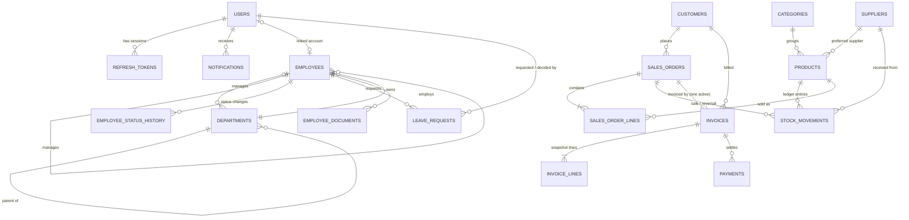

# Database

MySQL 8 (InnoDB, utf8mb4). The schema is created and evolved only by Flyway migrations in
`backend/src/main/resources/db/migration`; Hibernate runs with `ddl-auto=validate` and
refuses to start if entities and schema disagree. The same scripts run on H2 (MySQL mode)
for tests and on real MySQL in CI (Testcontainers).

| Migration | Content |
|---|---|
| `V1__core.sql` | company settings, users, refresh tokens, audit events, notifications, document sequences |
| `V2__organization_hr.sql` | departments, employees, status history, leave requests, employee documents |
| `V3__inventory_partners.sql` | customers, suppliers, categories, products, stock movements |
| `V4__sales_invoicing.sql` | sales orders and lines, invoices and lines, payments |

## Entity-relationship diagram

`company_settings` (single row), `audit_events` (append-only, no FK on the actor so history
survives user changes) and `document_sequences` stand alone.

## Important tables and constraints

| Table | Business constraints |
|---|---|
| `users` | `uk_users_email`; email stored lower-case; BCrypt hash (`{bcrypt}` prefix allows algorithm upgrades) |
| `refresh_tokens` | Only SHA-256 hashes stored (`uk_refresh_tokens_hash`); `family_id` groups a login's rotation chain |
| `company_settings` | `CHECK (id = 1)` singleton; payment terms 0–365 days |
| `employees` | Unique number, email and linked user; self-referencing manager |
| `leave_requests` | `CHECK (end_date >= start_date)`; overlap of pending/approved requests refused by the service |
| `products` | `uk_products_sku`; `CHECK (quantity_on_hand >= 0)`, non-negative prices and reorder level; `@Version` |
| `stock_movements` | Signed `quantity` (≠ 0) and resulting `quantity_after`; never updated or deleted |
| `customers` / `suppliers` | Unique code, email and tax ID (NULLs allowed) |
| `sales_order_lines` | `quantity > 0`, discount 0–100 %, unique `(order_id, line_no)` |
| `invoices` | `uk_invoices_number`; `due_date >= issue_date`; `0 <= amount_paid <= total` |
| `payments` | `amount > 0` |
| `document_sequences` | One row per prefix/year, locked `FOR UPDATE` while allocating |

### Types and time

- Money: `DECIMAL(19,2)`; rates: `DECIMAL(5,2)`; Java `BigDecimal`, HALF_UP at line level.
- Instants (`*_at`): `DATETIME(6)` in UTC (`hibernate.jdbc.time_zone=UTC`, connection
  `connectionTimeZone=UTC`). Business dates (`order_date`, `due_date`…): `DATE`, interpreted
  in the company time zone.

### Indexes

Every foreign key is indexed, plus the access paths of the main screens:
`products(name)`, `products(active, quantity_on_hand)` (low stock), `stock_movements(product_id, created_at)`,
`sales_orders(status, order_date)`, `invoices(status, due_date)` (overdue), `invoices(issue_date)`,
`payments(payment_date)`, `notifications(recipient_id, read_at, created_at)`,
`audit_events(occurred_at)`, `(action)`, `(entity_type, entity_id)`.

## Deletion and archival policy

Business records are **archived, not deleted**: users, products, customers, suppliers and
departments have an `active` flag; employees are terminated; orders and invoices are
cancelled. Foreign keys without cascade prevent deleting referenced rows. The only hard
deletes are: empty categories, employee documents (file + row, audited), expired refresh
tokens (nightly purge), and child rows cascaded with their parent (order lines on a draft
edit). Audit events and stock movements are append-only.

## Migration rules

1. Never edit a migration that has run anywhere; add `V<n>__description.sql`.
2. Write SQL that runs on both MySQL 8 and H2 MySQL mode (CI proves both).
3. Destructive changes (drop/rename column) go in two releases: expand, migrate data, then contract.
4. Back up before deploying a release that contains migrations (see DEPLOYMENT.md).
